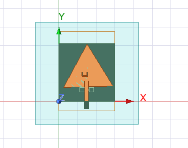
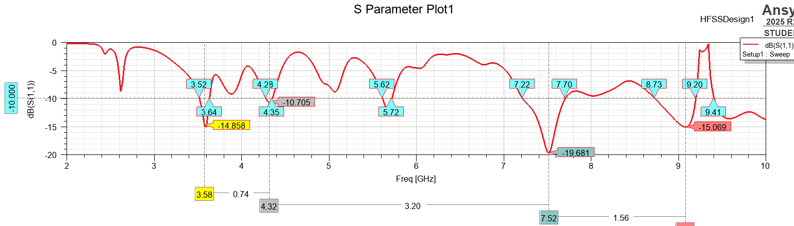
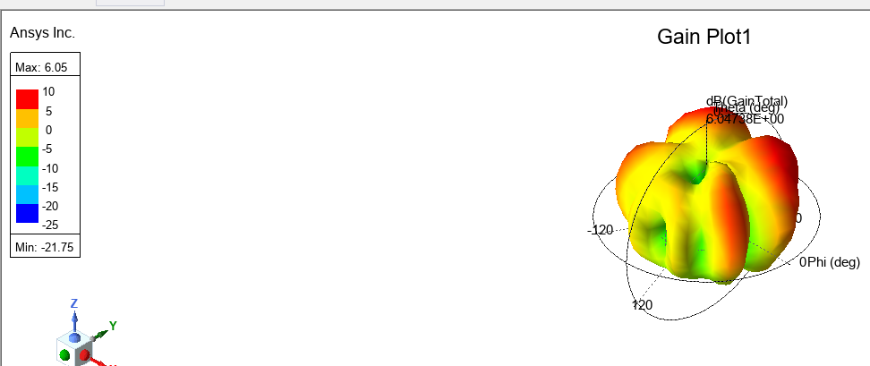

# Multi-Resonant Triangular Antenna – Design 04


## Project Description

Triangular antenna design with multiple visible S11 matched regions and a 3D gain-pattern simulation.

The repository presents the supplied HFSS geometry, S11 response and 3D gain-pattern screenshot, along with methodology, report templates and an analysis workflow.

## Author

**Laveti Seshadri**  
Electronics and Communication Engineering (ECE)

## Repository Contents

```text
Triangular-Antenna-Design-04/
├── README.md
├── LICENSE
├── .gitignore
├── requirements.txt
├── Images/
│   ├── 01_antenna_geometry.png
│   ├── 02_s11_parameter.png
│   └── 03_3d_gain_pattern.png
├── Results/
│   └── Simulation_Results.md
├── analysis/
│   └── analyze_s11.py
├── data/
│   ├── s11_export_template.csv
│   └── illustrative_s11_dataset.csv
├── figures/
│   └── illustrative_s11_curve.png
├── docs/
│   ├── Design_Parameters.md
│   ├── Methodology.md
│   ├── Technical_Report_Template.md
│   ├── Comparison_Template.md
│   └── GITHUB_UPLOAD_GUIDE.md
└── social/
    └── GITHUB_POST.md
```

## HFSS Geometry



## S11 Parameter



Displayed sweep: approximately 2–10 GHz. See [Simulation Results](Results/Simulation_Results.md) for screenshot-based observations and the distinction between visible readings and verified numerical data.

## 3D Gain Pattern



Gain plot legend: maximum 6.05, minimum -21.75. Confirm plotted quantity and units in HFSS before reporting these as dBi.

## Analysis Workflow

1. Export the HFSS S11 sweep as CSV.
2. Use the provided `analysis/analyze_s11.py` script.
3. Calculate resonant frequencies and continuous −10 dB bands from the exported data.
4. Record exact results in `Results/Simulation_Results.md`.

Example command:

```bash
python analysis/analyze_s11.py data/your_hfss_export.csv
```

The file `data/illustrative_s11_dataset.csv` and its chart are **synthetic demonstration material only**. They are not actual HFSS measurements and must not be used as research evidence.

## Design Parameters

Fill the actual dimensions and material properties from the native HFSS project in [Design Parameters](docs/Design_Parameters.md).

## Software

- ANSYS Electronics Desktop 2025 R2
- HFSS
- Python 3.9+ for optional analysis scripts

## License

Original documentation and images are offered under CC BY 4.0 as described in [LICENSE](LICENSE). Third-party software, trademarks and materials not owned by the author are excluded.
